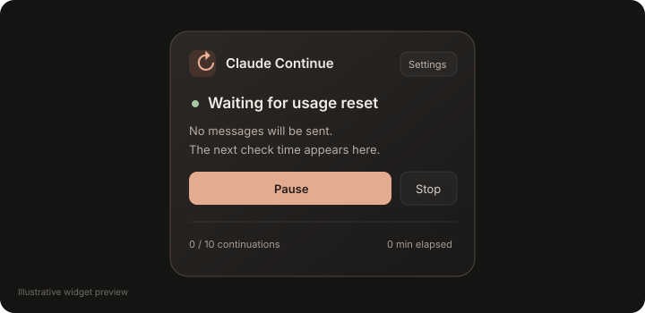

# Claude Continue

Automatic continuation controls for Claude Desktop on macOS.

[](LICENSE)
[](https://github.com/codexdimpudim/claude-continue/actions/workflows/tests.yml)
[](TEST-REPORT.md)

Keep Claude working on a task with a configurable continuation prompt, visible countdown, and clear Start, Pause, Resume, and Stop controls.

## Trailer

https://github.com/user-attachments/assets/511c82b3-3f44-4584-af2b-1d017a3e4069

**[Watch the trailer](https://github.com/codexdimpudim/claude-continue/blob/main/assets/ClaudeContinue_Trailer_4K.mp4)** · [Download the original 4K MP4](https://github.com/codexdimpudim/claude-continue/raw/refs/heads/main/assets/ClaudeContinue_Trailer_4K.mp4)  
Original: 40 seconds · 3840 × 2160 · 60 fps · stereo audio. The inline player uses a smaller playback copy. The trailer is an illustrative, time-condensed sequence; see the validation notes below for what has been tested in the app.

## At a glance



**Preview release:** 103 automated checks pass. App loading, the widget, Resume, and detection of the real free-message usage notice have been exercised on macOS. A real Start → countdown → send → generation → completed-response sequence was observed earlier. After repairing the October 13 overnight failure, a bounded live test also resumed the actual interrupted chat despite its missing completion marker: one continuation was acknowledged and Claude resumed generation. Sustained unattended loops and recovery after an actual usage reset remain unverified. See [the test report](TEST-REPORT.md).

[Installation guide](docs/INSTALLATION.md) · [Usage and settings](docs/USAGE.md) · [Troubleshooting](docs/TROUBLESHOOTING.md) · [Validation report](TEST-REPORT.md) · [Changelog](CHANGELOG.md) · [Code review findings](docs/CODE-REVIEW.md)

## What it does

- Greets you once with a skippable five-step tour; replay it from Settings when needed.
- Offers five color schemes and a compact view.
- Shows a tenth-of-a-second countdown, target time, and progress in Paranoid mode.
- Supports approval before each continuation and a one-continuation session mode.
- Lists recent operational activity and includes a keyboard pause shortcut.
- Continues after observed generation and confirmed, stable completion.
- Offers reusable prompts for coding, game development, or your own work.
- Displays why it paused and when it will check a usage warning again.
- Waits passively during usage limits or connection problems.
- Protects manual drafts and cancels when you interact with or change the chat.
- Limits continuation count and runtime, with optional keep-awake.
- Starts off after launch and allows only one active automation window.

The plugin uses a separately patched copy of the real Claude app. Your installed original stays intact. No Claude app binaries are included in this repository or its downloads.

## How continuation works

1. **You explicitly start it.** Opening the app alone never enables automation. Start binds the session to the selected existing chat.
2. **It checks the latest response.** If Claude is generating, it waits. If the latest response is already complete, it verifies a quiet period before scheduling. Explicit Start on an interrupted task verifies ten idle seconds instead.
3. **You get a countdown.** The delay is configurable, and you can cancel before submission.
4. **It checks again before sending.** The chat, controls, generation state, warnings, and composer must still be suitable. Human text is preserved.
5. **It submits once and looks for generation.** A response-scoped Continue/Resume control may be used; otherwise it inserts your configured prompt and clicks Send. Missing acknowledgment pauses instead of submitting again.
6. **It repeats within your limits.** Stable response completion can schedule the next continuation until you pause, stop, change chats, or hit a session safeguard.

This is UI automation inside Claude Desktop. It depends on the app’s visible controls and page structure. It does not use a separate API account, add Claude usage, or make Claude available after a Mac shutdown.

## Compatibility

| Requirement | Current support |
| --- | --- |
| Operating system | macOS |
| Claude Desktop | **2.31226.1**, exact inspected ASAR build |
| Hardware tested | Intel Mac |
| Apple Silicon | Universal app slices preserved; not tested on hardware |
| Installation tools | Python 3 and macOS `codesign` / `ditto` |
| API key or Node for everyday use | Not required |

Unknown app versions stop at the compatibility check. This is an independent project, unaffiliated with Anthropic.

## Install

1. Download and extract the [2.2.1 preview](https://github.com/codexdimpudim/claude-continue/releases/tag/v2.2.1-preview.1). Keep the folder together.
2. Quit Claude and double-click **Install.command**.
3. Resolve any macOS Keychain prompts yourself. Local signing can trigger them.
4. Open an existing chat in the local copy. The installer checks for one widget, the composer, and Send.
5. Use **Launch.command** to reopen this copy later. Opening the original Claude app loads the original app.

You can also use [Download source](https://github.com/codexdimpudim/claude-continue/archive/refs/heads/main.zip).

Installation creates a versioned backup before patching a separate copy. The inspected build requires local signing: **Touch ID/passkey authentication tied to Anthropic’s signing identity is unavailable in the local copy.** Other signing-dependent integrations remain unverified. Read [the architecture notes](ARCHITECTURE.md) before using the preview for important work.

## Use

On the first launch of this version, a short welcome tour explains the controls. It never opens automatically again in the same Claude profile, including after an update or restart. You can skip it or replay it using **Settings → Quick tour**. Automation remains off during the tour.

Open Settings, choose your continuation prompt and limits, then close Settings. Press **Start** in an existing chat. For a completed response, the card checks it and begins a cancellable countdown. During generation, it waits for Claude to finish. Starting during a usage limit preserves the request and schedules the continuation after availability is verified. A quota-interrupted reply may never get a completion toolbar; recovery instead verifies stable idle controls for an extra ten seconds. Start/Resume also handles a previously interrupted task after ten idle seconds, without pretending its reply completed.

Press **Pause** or **Cancel countdown** to cancel pending automation. Press **Resume** after a pause. **Stop** stops the automation without interrupting Claude’s current response. Editing the prompt pauses automation until you resume.

Start explicitly requests continuation of the latest assistant response. An empty chat pauses; send the first request normally. An existing user request with no assistant text can be resumed explicitly. Loading the widget alone never sends a message.

Defaults are a 10-second delay, 10 continuations, six hours, and a five-second minimum send cooldown. Unlimited limits retain the other safeguards. Uncertain delivery pauses instead of retrying a send.

When a usage notice appears, pending sends stop. Checks happen after 2, 5, 10, then 15 minutes, or after a recognized local reset time plus a buffer. A stale notice may require you to refresh manually. The feature does not change server-side usage limits.

## Settings

| Setting | Default | What it changes |
| --- | --- | --- |
| Color scheme | Terracotta | Terracotta, Ocean, Forest, Lavender, or Light; saved for later launches |
| Paranoid mode | Off | A live countdown in tenths of a second, scheduled target time, and progress bar; usage waits show the next passive check |
| Compact widget | Off | Smaller card while keeping controls and the optional countdown accessible |
| Ask before each continuation | Off | Waits for explicit approval after the countdown, then runs the normal final checks |
| Continue once, then pause | Off | Overrides the session count cap to one submission; waits for the reply to finish before pausing |
| Continuation prompt | Default project-continuation preset | Text to submit when there is no suitable response-scoped Continue control |
| Project instructions | Empty | Extra instructions appended to the continuation prompt |
| Delay | 10 seconds | Time to cancel after continuation is scheduled; configurable from 1–300 seconds |
| Maximum continuations | 10 | Submission cap for the enabled session; presets include 25, 50, 100, and Unlimited |
| Maximum runtime | 6 hours | Enabled-session time cap; presets include 1, 3, 6, 12, 24 hours, and Unlimited |
| Usage checks | 2, 5, 10, 15 minutes | Passive check intervals when no usable reset time is shown |
| Keep Mac awake | Off | Requests a native prevent-app-suspension assertion while automation is active |
| Debug logging | Off | Adds control/status metadata to local operational logs |

Prompt, delay, cap, and polling changes pause the session. Resume explicitly when the settings are ready. Resume creates a fresh session, resetting the continuation count and elapsed-session timer. Color scheme, Paranoid mode, compact view, keep-awake, and logging toggles do not reset the session. Approval and one-shot changes pause it. **Option + Shift + P** pauses an active session. Recent activity and diagnostics are available in Settings.

Paranoid mode shows the earliest scheduled send time, not a promise that Claude will accept a message at that instant. Final checks and the composer handoff may delay or cancel it. While Claude is working, no exact future send time is known; the widget says so. Approval mode can wait indefinitely and sends nothing until you approve.

Unlimited caps keep draft protection, the minimum send cooldown, warning checks, acknowledgment checks, and loop detection. Keep-awake allows the display to sleep and cannot guarantee operation with a closed laptop lid, a shutdown, or a network outage.

See [the usage guide](docs/USAGE.md) for presets, examples, and the status table.

## Update or remove

- **Update.command** checks the installed app before shutdown, backs up and stages plugin sources, then reopens the local copy. Failed replacements restore the previous sources. The app is not re-signed and preferences remain saved.
- **Uninstall.command** or **Restore Claude.command** closes and removes the managed copy, verifies the original app’s signature, and opens it. Backups and logs remain.
- **Check Compatibility.command** inspects the installed app without patching it.

Runtime: `~/Library/Application Support/ClaudeAutoContinue/Runtime/`  
Backups: `~/Library/Application Support/ClaudeAutoContinue/Backups/`  
Logs: `~/Library/Logs/ClaudeAutoContinue/`

These existing internal names remain unchanged for upgrade compatibility. Logs store operational metadata, not chat URLs, prompt text, or message bodies. Prompts stay in renderer localStorage. Response fingerprints stay in memory.

## Troubleshooting

| What you see | First thing to check |
| --- | --- |
| No widget | Open the managed copy using Launch.command, then open an existing chat |
| Paused after a settings change | Close Settings and press Resume |
| Your message is still in the composer | Send or clear your draft yourself, then Resume |
| Waiting for usage reset | Leave the wait active; it checks passively and does not bypass usage limits |
| Could not confirm the response finished | Check Claude’s reply and controls; the selector may need an update |
| No generation after a send | Review the chat before resuming; the plugin deliberately avoids a duplicate send |
| Another window is active | Pause the other automation window before enabling this one |
| Unknown version/build | Use Check Compatibility.command; do not bypass the hash/version gate |
| Startup is slow or asks for Keychain access | Resolve prompts yourself; after the chat opens, run Launch.command again to verify it |

[The troubleshooting guide](docs/TROUBLESHOOTING.md) covers recovery steps and the information to include in a bug report.

## Development

```sh
npm ci
npm run build
npm test
npm run test:update
```

The engine, DOM adapter, and mocked loader tests do not contact Claude. Python update tests use temporary folders. GitHub Actions runs the checks on Linux and macOS; neither CI job signs or launches Claude.

Canonical sources are `lib/engine.js`, `lib/renderer.js`, `macos/loader.cjs`, and `macos/manage.py`. Rebuild the committed standalone plugin after changes. See [CONTRIBUTING.md](CONTRIBUTING.md) for validation expectations.

## Project structure

| Path | Purpose |
| --- | --- |
| `lib/engine.js` | DOM-independent state machine, session caps, countdowns, warning classification, and recovery |
| `lib/renderer.js` | Claude DOM adapter, widget, settings, draft handling, and single-window ownership |
| `plugins/auto-continue.js` | Generated standalone bundle; rebuild it after changing the canonical sources |
| `macos/loader.cjs` | Origin-restricted injection, health reporting, metadata logs, and power assertions |
| `macos/manage.py` | Compatibility inspection, backups, copy patching/signing, source updates, launch, and removal |
| `macos/compatibility.json` | Inspected Claude version and original ASAR hash |
| `tests/` | Engine, DOM, mocked-loader, and isolated source-update regression checks |
| `docs/` | Installation, everyday usage, and troubleshooting guides |
| `assets/` | Widget illustration, trailer poster, and the original 4K trailer |

## Current limitations

- Only the exact listed Claude build is accepted. UI changes can require new selectors even when the desktop version remains the same.
- A successful live continuation has been observed; reliable multihour unattended operation has not been established. A later submission hit the acknowledgment timeout and paused, so the live check is not a completed soak test.
- Actual quota-reset recovery is simulated in tests but has not been fully observed live. A stale usage notice can need manual refresh.
- Apple Silicon hardware, physical network-loss recovery, enterprise authentication, and all signing-dependent integrations remain unverified.
- Local signing changes the copied app’s identity. The plugin is not notarized or endorsed by Anthropic.

The [validation report](TEST-REPORT.md) separates automated coverage from live observations.

## License and credits

[MIT](LICENSE). Derived from [Bluscream’s claude-desktop-plugin-system](https://github.com/Bluscream/claude-desktop-plugin-system), commit `c3f14f1c2d2d3b42aa0ff2567d785bb610575d0a`. The original copyright notice is preserved. Claude Continue adds the macOS copy-and-restore workflow, a tested continuation engine, and the redesigned widget.
